# VLC × Juxtopposed redesign

A working, unofficial Windows build of the VLC redesign presented by **Juxtopposed** in [the original video](https://www.youtube.com/watch?v=ERFeOgqk324), implemented from [her Figma Community file](https://www.figma.com/community/file/1691465999134370980/vlc-redesign).

This project modifies VLC's native interface and retains the VLC playback engine and existing native menus. It is based on VLC 4.0.0-dev; it is an independent implementation, not a release or endorsement from Juxtopposed or VideoLAN.

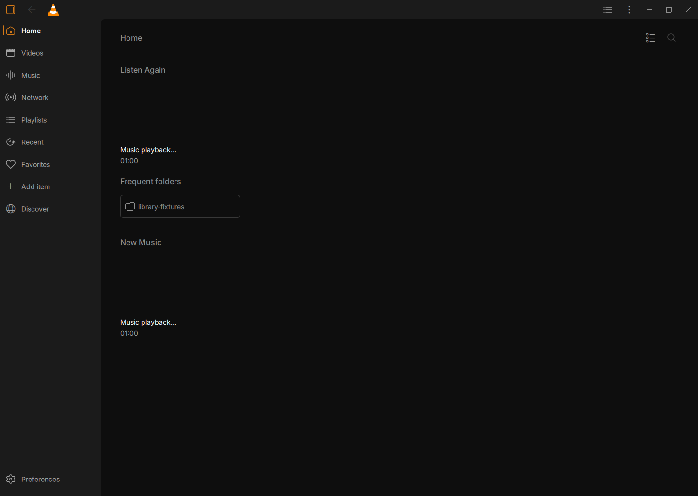

## Try the build

**Easiest:** download `VLC-Redesign-<version>-setup.exe` from the [Releases](../../releases) page and run it. It installs just for your account, needs no administrator rights, and leaves any existing VLC untouched.

You can also download the portable Windows x64 build from the same page. Each release includes:

- the portable build
- the matching modified VLC source
- the exact third-party library sources
- SHA-256 checksums

Extract the entire ZIP, then open `VLC-Redesign/vlc.exe`. Keep the folder intact. No installer or administrator access is needed. Settings and library data stay in the build's own `portable/` folder, and an installed VLC isn't affected.

See [Sharing and licensing](docs/SHARING.md) for the licences and how the corresponding source is provided.

## Completed video redesign

All 18 reviewed gaps are addressed, including the full settings registry, immediate millisecond bookmarks, dual folder/queue panels, actual cue dragging, complete presets, audio devices, shortcut key feedback and floating video. See the [18-item completion and validation report](docs/COMPLETION.md). Native reverse is kept where supported; otherwise the build provides a discrete, silent reverse video preview.

## What is implemented

| Area | Native implementation |
| --- | --- |
| Library | Home, video/music/network/playlists, grid/list, search, sorting, pins, favorites and watched state |
| Player | Redesigned controls, seek thumbnails, responsive timeline, fullscreen title and mini-player |
| Sidebar | Queue, Videos/library, bookmarks and chapters beside playback; the original queue model and operations are retained |
| Bookmarks | Ctrl+B saves the current timestamp immediately with a brief confirmation; rename, seek and remove in the sidebar |
| Settings | 13 categories, searchable native options, basic settings followed by Advanced Options, description info buttons |
| Shortcuts | Separate editor from Tools → Keyboard Shortcuts or Controls settings, native key capture and conflict handling |
| Customization | Control profiles, customizable toolbar and saved interface settings |
| Subtitles | Native subtitle controls, local matching/review, subtitle timeline and optional OpenSubtitles workflow |
| Original VLC tools | Existing disc, capture, conversion, streaming, effects and advanced native dialogs remain accessible |

“Implemented” does not certify every VLC device, protocol or edge case. See [validation and limitations](docs/VALIDATION.md).

## Screenshots

These are actual pixels from the instrumented native build on an isolated QA desktop, using synthetic local media and an empty test library. They are not Figma mockups or captures of a user's desktop. Native video output is a separate surface and may appear as a placeholder in the Qt capture.

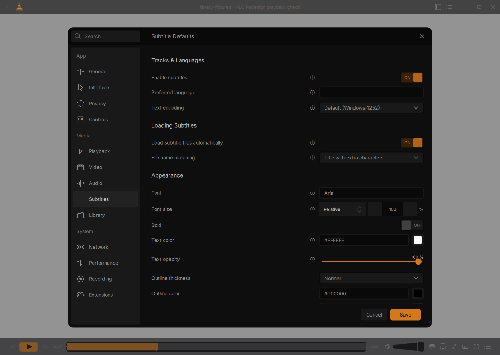
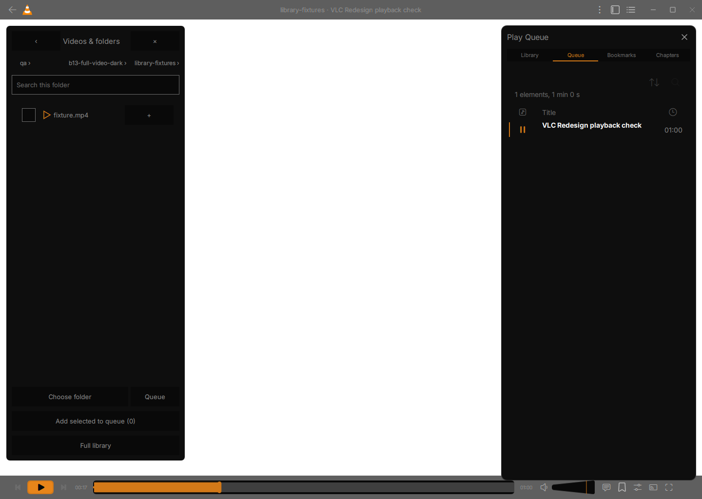
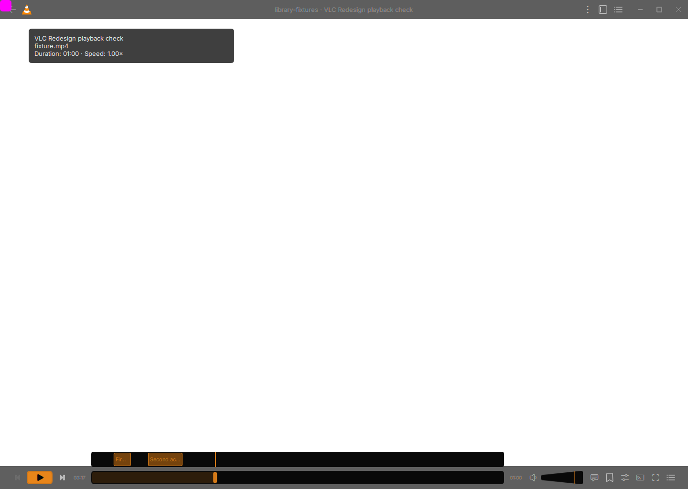
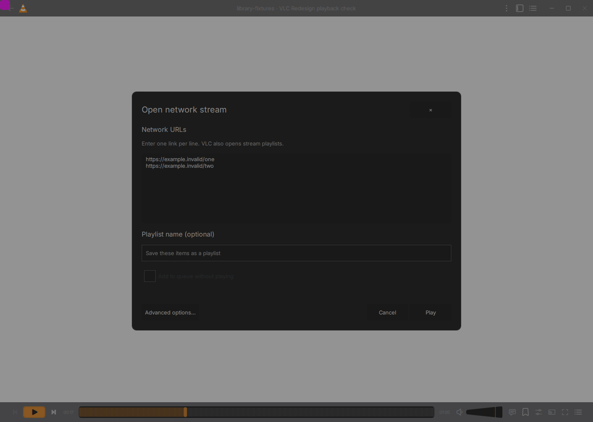
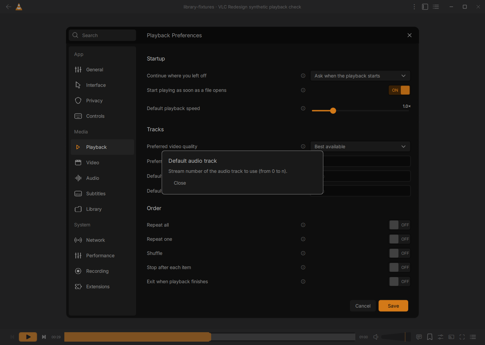
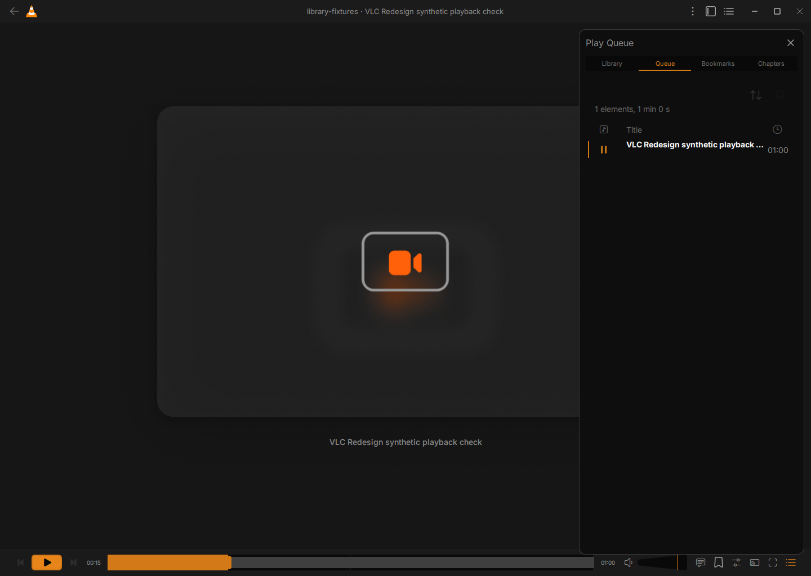
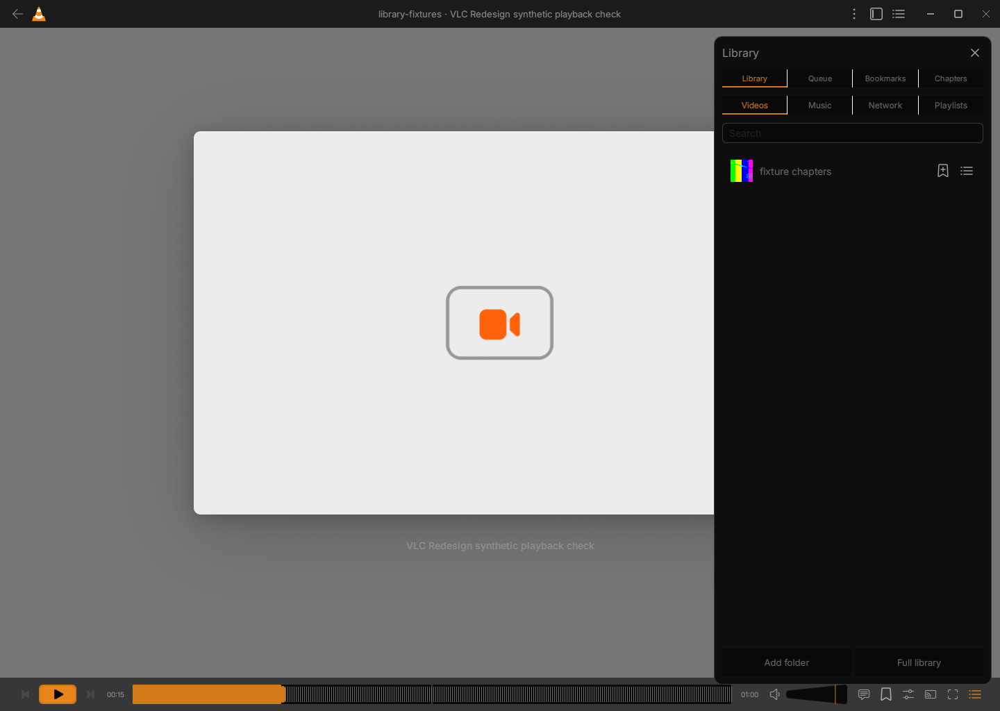
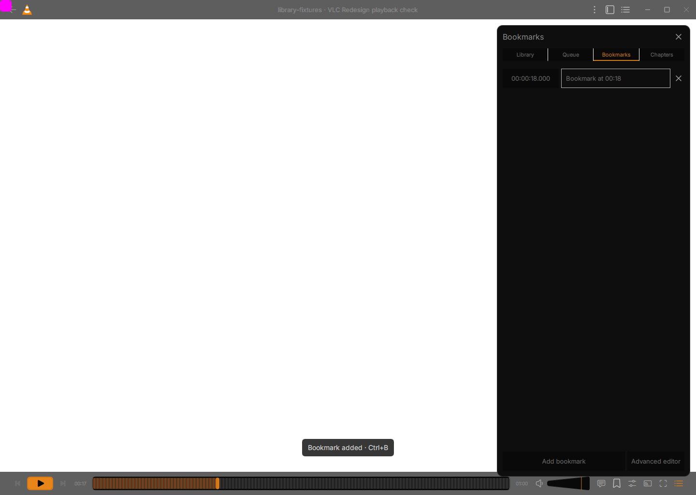
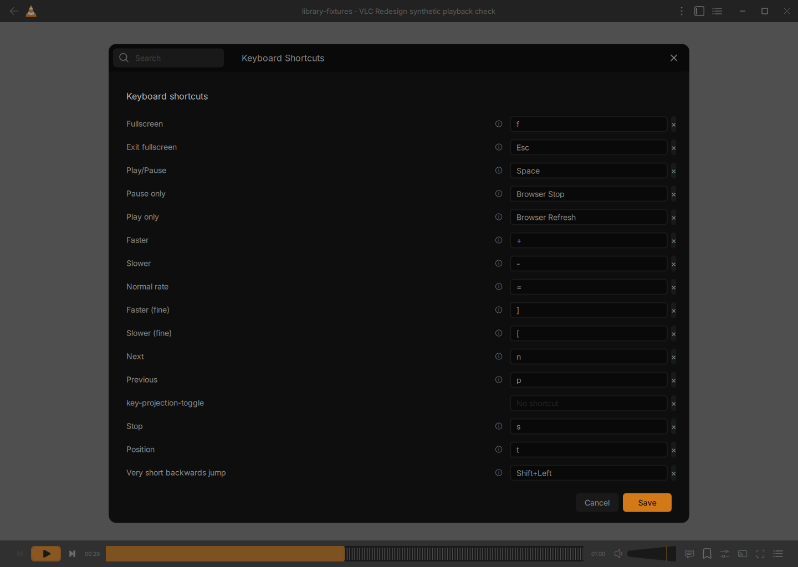
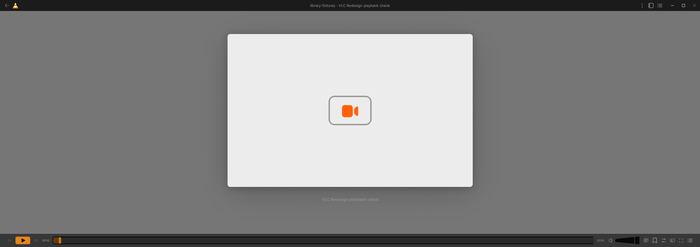

## Source and credits

The complete modified VLC source snapshot is in [`vlc/`](vlc/), with build information in [BUILD.md](docs/BUILD.md). Upstream revision and file hashes are recorded in `docs/source-manifest.json`. Original source headers and licences are retained.

Design: **VLC Redesign by Juxtopposed** — [video](https://www.youtube.com/watch?v=ERFeOgqk324) · [Figma](https://www.figma.com/community/file/1691465999134370980/vlc-redesign). Adaptations include native VLC integration, responsive layouts and working player/library/settings behavior.

VLC: **VideoLAN and VLC contributors** — [project](https://www.videolan.org/vlc/) · [upstream source](https://code.videolan.org/videolan/vlc). Inter: Rasmus Andersson and contributors, SIL Open Font License. Additional component notices remain with the source.

Read [ATTRIBUTION.md](ATTRIBUTION.md) and [SHARING.md](docs/SHARING.md) before redistributing. No video, transcript, commercial movie clips, Figma preview posters, user media, passwords or portable settings are included in this repository.
